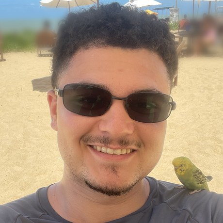

<a href="https://github.com/NicoDeVargas">
  
</a>

<table>
<tr>
<td width="190" valign="top">
  
</td>
<td valign="top">


Computer Engineering student at **CEFET-MG** (Belo Horizonte, Brazil 🇧🇷) and AI developer at **AI4Sellers**, where I went from intern to junior building AI sales simulators used by 1,000+ salespeople.

I like owning things end to end: architecture on AWS, the LLM pipeline, the benchmark that proves it works, and the deploy.

☕ Runs on coffee &nbsp;·&nbsp; 🎮 Elden Ring, still dodging Waterfowl Dance

</td>
</tr>
</table>

### ⚔️ Recent wins

| Result | How |
|---|---|
| **−71%** cost per voice simulation | Proposed a cascaded STT → LLM → TTS pipeline to replace a realtime API; validated with my own cost, latency and prompt-attack benchmark (US$ 0.48 → 0.14) |
| **40% → 0%** product hallucinations | Moved a B2B sales copilot from plain RAG on Postgres to hybrid graph RAG; measured on a 1,000-question test battery |
| **10–20 min → 2 min** CRM notes | Voice agent that interviews the salesperson right after a client meeting; empty CRM fields dropped from 45% to 0% |
| **~60%** AWS savings on pilots | Designed the multi-client AWS architecture (ECS, RDS, Lambda, CDK) and moved pilots to serverless |
| **11% → 93%** action accuracy | Fine-tuned Qwen3-8B with LoRA for in-game NPC dialogue with structured JSON actions |

### 🗡️ Featured projects

<table>
<tr>
<td width="33%" valign="top">

**[qwen3-npc-dialogue-lora](https://github.com/NicoDeVargas/qwen3-npc-dialogue-lora)**<br>
LoRA fine-tune of Qwen3-8B that plays the NPCs of my Godot RPG and returns JSON the game executes. Includes why merging and requantizing to Q4 dropped accuracy from 90% to 30%.<br><br>
`PyTorch` `PEFT` `llama.cpp` `AWS`

</td>
<td width="33%" valign="top">

**[Fluente](https://github.com/NicoDeVargas/fluente-ia-avaliador-de-leitura)**<br>
A child reads aloud for one minute; Fluente returns words correct per minute and marks every word, with a deterministic aligner and no LLM in the scoring. [Live demo](https://fluente-black.vercel.app)<br><br>
`Next.js` `AssemblyAI` `Supabase`

</td>
<td width="33%" valign="top">

**[Sinal de Alarme](https://github.com/NicoDeVargas/sinal-de-alarme-AssemblyAI-Voice-Agent-Hackathon)**<br>
Voice training for dengue warning signs: health workers interview a virtual patient who hides what matters, then get a graded correction. AssemblyAI Voice Agent Hackathon.<br><br>
`Voice agents` `TypeScript`

</td>
</tr>
</table>

### 🛠️ Toolkit


📜 Working on **AWS Certified AI Practitioner** and **AWS Certified AI Business Strategist** (Nov 2026).

<details>
<summary>🌸 <b>Boss fight</b></summary>

```text
⠀⠀⠀⠀⠀⠀⠀⠀⠀⠀⠀⠀⠀⠀⠀⠀⠀⠀⠀⠀⠀⠀⠀⠀⠀⠀⠀⠀⠀⠀⠀⠀⠀⠀⠀⠀⠀⠀⠀⠀⠀⠀⠀⣀⡀⠀⠀⠀⠀⠀⠀⠀⠀⠀⠀⠀⠀⠀⠀⠀⠀⠀⠀⠀⠀⠀⠀⠀⠀
⠀⠀⠀⠀⠀⠀⠀⠀⠀⠀⠀⠀⠀⠀⠀⠀⠀⠀⠀⠀⠀⠀⠀⠀⠀⠀⠀⠀⣷⡄⠀⠀⠀⠀⠀⢀⣀⣀⣤⡤⡤⢼⠫⠩⡉⠻⠴⠤⠤⣤⠀⠀⠀⠀⠀⠀⠀⠀⠀⠀⠀⠀⠀⠀⠀⠀⠀⠀⠀
⠀⠀⠀⠀⠀⠀⠀⠀⠀⠀⠀⠀⠀⠀⠀⠀⠀⠀⠀⠀⠀⠀⠀⠀⠀⠀⠀⠀⣷⣿⡦⠤⢶⣚⣯⠭⠽⠖⠚⠛⠛⡗⡹⠰⡨⡐⣿⠉⠉⠛⠓⠂⠀⠀⠀⠀⠀⠀⠀⠀⠀⠀⠀⠀⠀⠀⠀⠀⠀
⠀⠀⠀⠀⠀⠀⠀⠀⠀⠀⠀⠀⠀⠀⠀⠀⠀⠀⠀⠀⠀⠀⠀⠀⢀⣠⡴⣖⣻⣼⡇⣿⠉⠁⣀⣀⡀⠀⠀⠀⢀⡟⠉⠛⣧⢅⠹⡆⠀⠀⠀⠀⠀⠀⠀⠀⠀⠀⠀⠀⠀⠀⠀⠀⠀⠀⠀⠀⠀
⠀⠀⠀⠀⠀⠀⠀⠀⠀⠀⠀⠀⠀⠀⠀⠀⠀⠀⠀⠀⠀⣀⡴⣞⡯⠗⠋⠉⠈⣗⣧⣻⡝⡿⣹⢫⢿⡳⣦⣀⣼⠃⠀⠀⠘⣇⠣⢻⡄⠀⠀⠀⠀⠀⠀⠀⠀⠀⠀⠀⠀⠀⠀⠀⠀⠀⠀⠀⠀
⠀⠀⠀⠀⠀⠀⠀⠀⠀⠀⠀⠀⠀⠀⠀⠀⠀⠀⣠⣴⣾⠟⠋⠁⠀⠀⠀⠀⠀⢿⠹⡦⣻⢮⢾⣪⡻⡇⡢⣧⡏⠀⠀⠀⠀⣿⠸⢄⠝⣆⠀⠀⠀⠀⠀⠀⠀⠀⠀⠀⠀⠀⠀⠀⠀⠀⠀⠀⠀
⠀⠀⠀⠀⠀⠀⠀⠀⠀⠀⠀⠀⠀⠀⠀⢀⣴⡾⠟⠉⠀⠀⠀⠀⠀⠀⠀⠀⢀⣼⣿⣾⣿⢯⣷⡷⣽⡣⣕⣽⠀⠀⠀⠀⠀⣿⣝⠌⡎⡸⣧⠀⠀⠀⠀⠀⠀⠀⠀⠀⠀⠀⠀⠀⠀⠀⠀⠀⠀
⠀⠀⠀⠀⠀⠀⠀⠀⠀⠀⠀⠀⠀⣠⣶⠟⠉⠀⠀⠀⠀⠀⠘⡧⡤⡤⠴⡚⠉⠄⣿⡻⣿⣿⣾⣿⡾⣟⣴⣿⠀⠀⠀⠀⠀⣽⣧⡗⡊⠒⢜⣇⠀⠀⠀⠀⠀⠀⠀⠀⠀⠀⠀⠀⠀⠀⠀⠀⠀
⠀⠀⠀⠀⠀⠀⠀⠀⠀⠀⢀⣰⡾⠋⠁⠀⠀⠀⣀⣤⠴⢖⠓⢇⠅⠔⡠⡨⠠⠁⣹⣏⣯⣻⣿⣿⣿⣿⠟⡙⢧⣄⠀⠀⠀⠙⣏⡤⠱⠑⡱⢸⠀⠀⠀⠀⠀⠀⠀⠀⠀⠀⠀⠀⠀⠀⠀⠀⠀
⠀⠀⠀⠀⠀⠀⠀⠀⢀⣴⡿⠋⠀⠀⠀⢀⣴⡿⡻⠫⢪⠠⢊⢐⣡⢕⠎⢔⣤⢷⡝⣻⡻⣾⣯⣯⠿⠟⣁⣘⣦⣽⣧⣠⣤⡶⣿⠽⡱⣩⣂⡟⠀⠀⠀⠀⠀⠀⠀⠀⠀⠀⠀⠀⠀⠀⠀⠀⠀
⠀⠀⠀⠀⠀⠀⠀⣠⡿⠋⠀⠀⠀⢀⡴⡫⡱⣑⢬⠪⠂⠂⢓⠉⢀⠂⢥⣟⣞⡝⣏⣵⡾⣫⣣⣵⣿⣻⣿⡿⣿⠻⡟⡝⡍⡍⡢⡡⠣⣿⠉⠀⠀⠀⢀⡴⠂⠀⠀⠀⠀⠀⠀⠀⠀⠀⠀⠀⠀
⠀⠀⠀⠀⠀⢠⣾⠋⠀⠀⠀⠀⠀⡾⡱⣽⠛⠉⢹⠄⡜⣨⡀⡆⢜⢐⢼⣯⢺⡽⢱⡟⣾⣻⣿⣿⢿⣻⡚⢿⡠⢍⢪⡣⡣⣪⡮⢖⠛⣻⣄⠀⠀⢀⣼⠀⠀⠀⠀⠀⠀⠀⠀⠀⠀⠀⠀⠀⠀
⠀⠀⠀⠀⣰⡟⠁⠀⠀⠀⠀⠀⠀⣷⠿⢿⠀⠀⣾⡅⡆⣿⣜⡠⠃⠐⣼⣏⣿⠀⣾⡧⣿⢺⣿⣟⡽⣖⢭⣚⣗⣵⣱⣵⢛⠁⠠⠨⢻⡄⡟⠛⠛⠛⠁⠀⠀⠀⠀⠀⠀⠀⠀⠀⠀⠀⠀⠀⠀
⠀⠀⢀⣼⠋⠀⠀⠀⠀⠀⠀⠀⠀⠹⡄⠈⠙⣿⣏⣷⡱⣧⠀⠻⣄⠰⣇⢇⡇⡀⣿⣷⡽⢽⣺⣮⣫⣮⣧⠞⢟⠙⡔⠈⢰⠈⢂⠀⢼⣷⠃⠀⠀⠀⠀⠀⠀⠀⠀⠀⠀⠀⠀⠀⠀⠀⠀⠀⠀
⠀⠀⣼⠃⠀⠀⠀⠀⠀⠀⠀⠀⠀⠀⣿⡄⠀⠋⠈⠙⣧⢚⢧⠀⢻⠀⢷⣹⠁⠐⡪⡳⣽⡾⠪⠭⠕⢊⠄⢁⠂⡂⢱⢓⠈⠃⠀⡀⣇⡇⠀⠀⠀⠀⠀⠀⠀⠀⠀⠀⠀⠀⠀⠀⠀⠀⠀⠀⠀
⠀⣾⠁⠀⠀⠀⠀⠀⠀⠀⣀⣤⠴⢞⡽⠁⢸⣁⠀⢀⡿⣻⡸⣧⠼⠄⢐⠝⡂⢁⠇⡅⣣⢪⠢⢁⡃⢎⢆⠱⠸⠀⢯⡢⣓⠀⡁⣬⣻⡟⠒⠢⠀⠀⠀⠀⠀⠀⠀⠀⠀⠀⠀⠀⠀⠀⠀⠀⠀
⠸⠃⠀⠀⠀⠀⠀⠀⠀⣼⣱⠶⠚⠋⠁⠀⢸⡹⡦⢾⠵⡟⠿⢸⢈⠊⠠⠁⠄⢸⣘⢬⡺⢨⢇⢜⢌⢮⠢⢝⠌⡊⡎⣯⢑⠈⣔⣇⣈⢻⣆⡀⠀⠀⠀⠀⠀⠀⠀⠀⠀⠀⠀⠀⠀⠀⠀⠀⠀
⠀⠀⠀⠀⠀⠀⠀⠀⢀⣿⠇⠀⠀⠀⣦⢤⡼⠞⢺⣆⣧⢞⢌⠢⠡⠈⠔⠨⡀⠈⢾⡐⣇⢣⠣⡜⡔⡕⡍⡎⡎⠄⣻⡇⢕⠰⡏⠉⠛⠋⠀⠸⠀⠀⠀⠀⠀⠀⠀⠀⠀⠀⠀⠀⠀⠀⠀⠀⠀
⠀⠀⠀⠀⠀⠀⠀⠀⠸⣇⠀⠀⠀⢀⣼⣾⣇⣀⣼⠿⢝⣼⠬⣾⣀⠪⠨⣸⠯⣦⠘⣧⡧⢪⡱⡑⣜⢢⡣⢹⢊⠲⣮⠪⡅⢀⠷⣄⡀⠀⠀⠀⠀⠀⠀⠀⠀⠀⠀⠀⠀⠀⠀⠀⠀⠀⠀⠀⠀
⠀⠀⠀⠀⠀⠀⠀⠀⠀⠘⠀⠀⠀⢸⡄⠈⠉⠹⣿⢝⣼⠁⠀⠈⡇⡉⠄⣿⠀⠙⣧⢈⢻⠲⠏⢸⡲⣝⢮⣞⣑⣼⡉⡅⣳⡖⠒⢻⣧⣀⠀⠀⠀⠀⠀⠀⠀⠀⠀⠀⠀⠀⠀⠀⠀⠀⠀⠀⠀
⠀⠀⠀⠀⠀⠀⠀⠀⠀⠀⠀⠀⠀⠘⠇⠀⠀⠀⠏⠙⢿⡄⢸⣤⣗⣆⣷⢼⣧⣀⣸⡇⡜⡯⢞⡫⣉⣻⣿⣱⣾⣶⢣⢈⢂⣿⠀⠀⠀⠀⠀⠀⠀⠀⠀⠀⠀⠀⠀⠀⠀⠀⠀⠀⠀⠀⠀⠀⠀
⠀⠀⠀⠀⠀⠀⠀⠀⠀⠀⠀⠀⠀⠀⠀⠀⠀⠀⠀⠀⢾⠁⠀⠉⠉⣿⠃⠀⠀⢹⣻⣤⢾⢑⣡⣹⣾⢟⡕⣿⣿⣽⡦⣦⡷⣿⢦⢤⡤⢤⢤⣄⡀⠀⠀⠀⠀⠀⠀⠀⠀⠀⠀⠀⠀⠀⠀⠀⠀
⠀⠀⠀⠀⠀⠀⠀⠀⠀⠀⠀⠀⠀⠀⠀⠀⠀⠀⠀⠀⠈⠁⠀⠀⠀⠙⠢⡀⠘⣿⣿⣵⢷⣟⣗⣯⢶⣫⡿⣝⣷⣿⣿⣽⡷⣪⢽⡕⢌⠈⠂⠊⣻⡄⠀⠀⠀⠀⠀⠀⠀⠀⠀⠀⠀⠀⠀⠀⠀
⠀⠀⠀⠀⠀⠀⠀⠀⠀⠀⠀⠀⠀⠀⠀⠀⠀⠀⠀⠀⠀⠀⠀⠀⠀⠀⠀⢀⣴⢫⢕⣚⣮⢿⣽⡽⣛⢧⣫⣞⣿⣺⣧⠷⡻⣜⢇⠎⡐⡈⠄⠁⠄⣧⠀⠀⠀⠀⠀⠀⠀⠀⠀⠀⠀⠀⠀⠀⠀
⠀⠀⠀⠀⠀⠀⠀⠀⠀⠀⠀⠀⠀⠀⠀⠀⠀⠀⠀⠀⠀⠀⠀⠀⠀⠀⣴⣯⣵⣷⢟⢏⣷⡿⡻⣚⢎⢧⢗⣗⣿⢏⡳⢯⢳⢊⣥⠐⡀⠂⠈⡈⢴⠇⠀⠀⠀⠀⠀⠀⠀⠀⠀⠀⠀⠀⠀⠀⠀
⠀⠀⠀⠀⠀⠀⠀⠀⠀⠀⠀⠀⠀⠀⠀⠀⠀⠀⠀⠀⠀⠀⠀⠀⣠⣾⠿⢟⢩⣲⢵⡻⣽⡺⣹⡜⣎⢗⡽⣞⣣⣕⢝⣧⡷⣟⣽⣆⠠⠈⢀⢢⡏⠀⠀⠀⠀⠀⠀⠀⠀⠀⠀⠀⠀⠀⠀⠀⠀
⠀⠀⠀⠀⠀⠀⠀⠀⠀⠀⠀⠀⠀⠀⠀⠀⠀⠀⠀⠀⠀⠀⣰⢞⢝⠜⣌⡮⡚⠕⢹⡸⡮⡺⡢⡳⡱⡝⡎⣎⢶⢽⡾⡯⡻⣼⣟⣯⡷⠧⡶⣾⠀⠀⠀⠀⠀⠀⠀⠀⠀⠀⠀⠀⠀⠀⠀⠀⠀
⠀⠀⠀⠀⠀⠀⠀⠀⠀⠀⠀⠀⠀⠀⠀⠀⠀⠀⠀⠀⠀⣼⠗⣑⡴⡋⠡⠂⠐⠀⠡⠻⣕⡕⡽⡺⢌⠎⡜⡴⣱⣿⣿⢯⡳⣝⢗⣽⡻⡩⣺⠇⠀⠀⠀⠀⠀⠀⠀⠀⠀⠀⠀⠀⠀⠀⠀⠀⠀
⠀⠀⠀⠀⠀⠀⠀⠀⠀⠀⠀⠀⠀⠀⠀⠀⠀⠀⠀⢠⣞⢵⠺⢩⠂⠁⠐⠀⡁⠐⠀⠁⢊⠛⠷⢯⢮⠧⢗⢏⣕⣿⡿⡽⣝⣎⢯⢞⢼⣸⡟⠀⠀⠀⠀⠀⠀⠀⠀⠀⠀⠀⠀⠀⠀⠀⠀⠀⠀
⠀⠀⠀⠀⠀⠀⠀⠀⠀⠀⠀⠀⠀⠀⠀⠀⠀⠀⣠⡿⡕⠅⠃⢀⠠⠈⠀⡁⠄⠄⠨⠀⠅⢀⠪⡰⡃⠧⢑⢲⣺⡷⣿⢽⣝⣮⢫⢞⡼⣿⠀⠀⠀⠀⠀⠀⠀⠀⠀⠀⠀⠀⠀⠀⠀⠀⠀⠀⠀
⠀⠀⠀⠀⠀⠀⠀⠀⠀⠀⠀⠀⠀⠀⠀⠀⠀⣰⠫⠑⠐⠀⡈⠀⡀⠄⢁⢐⠈⠄⠡⠠⠈⡆⢕⠕⡥⡫⡢⣳⣿⣽⡾⣟⡾⣕⡵⢏⠩⣻⡇⠀⠀⠀⠀⠀⠀⠀⠀⠀⠀⠀⠀⠀⠀⠀⠀⠀⠀
⠀⠀⠀⠀⠀⠀⠀⠀⠀⠀⠀⠀⠀⠀⠀⢀⣼⠃⡁⠅⠐⠀⠠⠀⠠⠐⠐⠐⢈⠠⠀⢔⢜⢔⡝⢼⢨⣓⣿⣽⣿⣾⣿⢟⣯⢞⠍⠄⡐⢘⣧⠀⠀⠀⠀⠀⠀⠀⠀⠀⠀⠀⠀⠀⠀⠀⠀⠀⠀
⠀⠀⠀⠀⠀⠀⠀⠀⠀⠀⠀⠀⠀⠀⢀⣼⠁⡁⢀⠐⢈⠈⠠⠐⢀⠐⠠⠡⠀⠆⡁⡧⡃⡞⢌⡾⡸⣺⣯⣿⡿⣿⡯⣿⢗⢪⢌⢺⡀⠂⢿⣦⡀⠀⠀⠀⠀⠀⠀⠀⠀⠀⠀⠀⠀⠀⠀⠀⠀
⠀⠀⠀⠀⠀⠀⠀⠀⠀⠀⠀⠀⠀⠀⣾⠥⠀⠀⠄⡀⢢⠈⡀⠂⢂⠀⠅⢊⠨⡨⣸⢱⡽⣘⡾⣽⣿⣿⣾⢷⡿⣿⢻⡇⡵⡑⡎⣎⢎⡎⡂⡚⣷⣄⠀⠀⠀⠀⠀⠀⠀⠀⠀⠀⠀⠀⠀⠀⠀
⠀⠀⠀⠀⠀⠀⠀⠀⠀⠀⠀⠀⢀⣼⠇⢐⠈⠀⠌⠀⠅⡀⠄⠠⡁⠄⠌⠔⠠⣳⡻⣾⣱⣽⢽⡿⣷⣟⣽⣯⣾⣪⢟⢽⢸⢕⡜⡜⣕⢽⡄⠕⣝⢽⣀⡀⠀⠀⠀⠀⠀⠀⠀⠀⠀⠀⠀⠀⠀
⠀⠀⠀⠀⠀⠀⠀⠀⠀⠀⠀⠀⢀⡏⢂⠠⠀⡂⠁⠌⡐⠀⠂⠐⢐⠀⠡⠡⡵⢟⣽⣳⣳⢳⡗⣿⡽⣻⣻⣻⢯⣿⠭⡺⣡⢝⢦⠻⡜⣆⡛⣮⡢⡝⣜⢷⣦⠀⠀⠀⠀⠀⠀⠀⠀⠀⠀⠀⠀
⠀⠀⠀⠀⠀⠀⠀⠀⠀⠀⠀⠀⢸⠋⠀⠄⠅⠔⠁⡊⠄⠅⠂⠁⠢⢈⠨⠰⣙⣿⢫⡻⣎⣻⢇⣿⣿⡳⣷⣯⡏⣯⡺⡕⣟⡜⡽⡣⣻⡘⡮⣝⢾⡳⡢⡋⡫⢹⠷⢶⣀⣀⠀⠀⠀⠀⠀⠀⠀
⠀⠀⠀⠀⠀⠀⠀⠀⠀⠀⠀⢀⡿⠈⢈⠈⠌⡐⠅⢢⢡⢁⢂⠁⠌⡀⢂⡑⡁⠇⠅⣗⢵⡹⣵⣿⢻⣻⡻⢾⣳⢳⡣⣫⢺⣎⡗⣻⡜⡵⡊⢝⣮⢷⣩⠪⣂⢂⢑⠙⠬⢹⡴⠦⠤⠶⠶⢶⡇
⠀⠀⠀⠀⠀⠀⠀⠀⠀⠀⠀⢈⡇⠂⠐⠈⠌⠠⡑⠨⢒⠄⠂⠅⢂⢈⠀⡆⠌⢣⢑⢳⠩⣿⣪⣿⣽⣞⡾⣟⠇⡐⡫⠵⠩⣖⢍⠆⢻⡨⡝⢔⠸⢵⣚⠧⡊⡐⢢⢑⢐⠄⡈⢈⠐⠐⢐⠞⠀
⠀⠀⠀⠀⠀⠀⠀⠀⠀⠀⠀⠈⡇⠄⠂⠁⠨⢀⠂⠌⡀⡂⠨⠐⡐⠡⢂⢑⠨⣐⡰⢸⢰⢽⣾⡿⠨⣙⣾⠏⡀⠄⡢⡡⠂⠜⡪⡜⠔⢝⡌⢧⢱⠠⠓⢝⢵⢪⢐⠈⡀⠔⠐⠠⢠⡼⠋⠀⠀
⠀⠀⠀⠀⠀⠀⠀⠀⠀⠀⠀⠘⡇⠄⠐⠈⠨⠠⡈⡢⣐⡠⡢⣅⢊⠈⡆⡪⢊⢆⢇⢃⠵⣿⣷⡟⢌⢜⡃⡪⡐⠐⣺⢰⠠⠡⠙⣔⡅⢂⢳⡪⢕⡍⠣⡑⡱⡕⡳⣅⡐⢀⢢⣵⠟⠁⠀⠀⠀
⠀⠀⠀⠀⠀⠀⠀⠀⠀⠀⠀⢰⡇⡑⣤⡵⠗⠛⠉⠉⠉⢹⠓⠒⠳⣖⣵⣥⣱⢑⡕⢰⡝⣽⣾⡇⢅⠗⡈⢲⠐⠡⡹⡮⢮⠂⠡⡳⣳⢢⢁⠹⡦⢛⣜⢈⠢⢉⠕⡆⣕⣶⠛⠁⠀⠀⠀⠀⠀
⠀⠀⠀⠀⠀⠀⠀⠀⠀⠀⠀⠀⠿⠼⠉⠀⠀⠀⠀⠀⡤⠋⠀⠀⠀⠁⠀⠈⢙⠓⠺⢾⣫⣪⣷⡇⢕⢧⠱⢘⡆⠁⢆⢫⢞⢧⢁⢚⢮⣻⡢⠁⢎⢷⠪⣖⣨⣦⠷⠛⠉⠑⢠⡄⠀⠀⠀⠀⠀
⠀⠀⠀⠀⠀⠀⠀⠀⠀⠀⠀⠀⠀⠀⠀⠀⠀⠀⠀⠀⠀⠀⠀⠀⠀⠀⠀⣠⡏⠀⠀⣼⢗⢽⣵⡇⢯⣼⣼⣔⣣⣨⣰⣑⢿⢸⢢⢂⢍⣮⡽⣮⣼⠼⠗⠲⣏⡀⠀⠀⠀⠀⠀⠀⠀⠀⠀⠀⠀
⠀⠀⠀⠀⠀⠀⠀⠀⠀⠀⠀⠀⠀⠀⠀⠀⠀⠀⠀⠀⠀⠀⠀⠀⠀⠀⠀⡏⠀⠀⠀⢸⣿⣸⢵⣷⠛⠀⠀⠈⠉⠉⠉⠉⠉⢻⣿⠉⠉⠉⠙⠏⠀⠀⠀⠀⠀⠀⠀⠀⠀⠀⠀⠀⠀⠀⠀⠀⠀
⠀⠀⠀⠀⠀⠀⠀⠀⠀⠀⠀⠀⠀⠀⠀⠀⠀⠀⠀⠀⠀⠀⠀⠀⠀⠀⠀⠁⠀⠀⠀⣾⣞⡞⣽⣻⠀⠀⠀⠀⠀⠀⠀⠀⠀⠀⠀⠃⠀⠀⠀⠀⠀⠀⠀⠀⠀⠀⠀⠀⠀⠀⠀⠀⠀⠀⠀⠀⠀
⠀⠀⠀⠀⠀⠀⠀⠀⠀⠀⠀⠀⠀⠀⠀⠀⠀⠀⠀⠀⠀⠀⠀⠀⠀⠀⠀⠀⠀⠀⢰⡇⡆⡆⢌⣹⠀⠀⠀⠀⠀⠀⠀⠀⠀⠀⠀⠀⠀⠀⠀⠀⠀⠀⠀⠀⠀⠀⠀⠀⠀⠀⠀⠀⠀⠀⠀⠀⠀
⠀⠀⠀⠀⠀⠀⠀⠀⠀⠀⠀⠀⠀⠀⠀⠀⠀⠀⠀⠀⠀⠀⠀⠀⠀⠀⠀⠀⠀⠀⠘⠋⠉⠙⠛⠛⠀⠀⠀⠀⠀⠀⠀⠀⠀⠀⠀⠀⠀⠀⠀⠀⠀⠀⠀⠀⠀⠀⠀⠀⠀⠀⠀⠀⠀⠀⠀⠀⠀
```

<p align="center"><i>Let me solo her.</i><br><sub>Malenia, after the painting by <a href="https://redgryphon.tumblr.com/post/718970603876515841/malenia-blade-of-miquella-pose-based-on-an">redgryphon</a>, converted to braille dots</sub></p>
</details>

### 📫 Reach me

<a href="https://www.linkedin.com/in/nicolas-de-vargas-446435221/"></a>
<a href="mailto:nicolas.vargas8@gmail.com"></a>
<a href="https://www.instagram.com/nicorvg/"></a>


